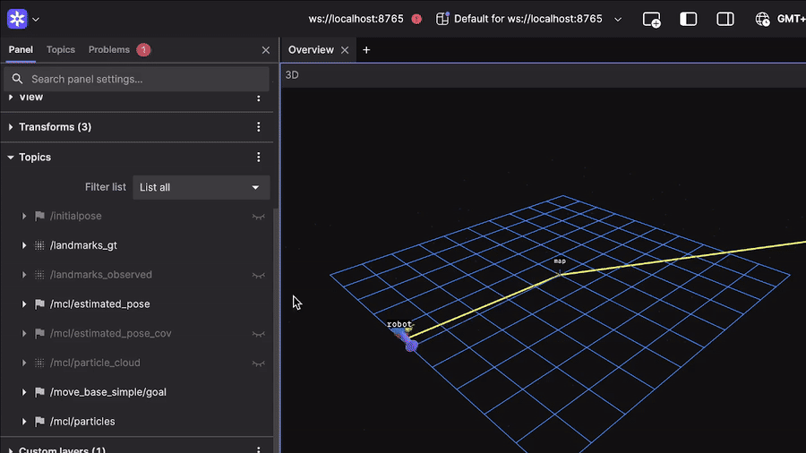

# Monte Carlo Localization (ROS 2)

A particle filter for 2D robot localization in a landmark-based map, implemented in Python as a ROS 2 node.
The robot starts with no knowledge of its pose (global localization); particles are spread uniformly over the
map and converge to the true pose using noisy odometry and landmark observations.



*Estimated pose (MCL) following the robot over time, visualized in Foxglove.*

## How it works

| Step | Implementation |
|------|----------------|
| Initialization | Particles drawn uniformly in x, y and θ ∈ [-π, π], equal weights |
| Motion update | Odometry increment in the robot frame, applied relative to each particle's heading, with Gaussian noise scaled by translation/rotation (α1–α4) |
| Measurement update | Observed landmarks (robot frame) transformed into the map frame per particle and compared to known landmark positions; Gaussian likelihood computed in log space for numerical stability |
| Resampling | Low-variance (systematic) resampling, triggered adaptively when the effective particle count N_eff drops below a threshold |
| Pose estimate | Weighted mean for x, y; circular mean for θ; weighted covariance for uncertainty |

## Files

- `particle_filter.py` – the particle filter (no ROS dependency)
- `mcl_node.py` – ROS 2 node wrapping the filter

## ROS 2 interface

**Subscribed topics**

| Topic | Type | Purpose |
|-------|------|---------|
| `/robot_noisy` | `nav_msgs/Odometry` | Noisy odometry for the motion update |
| `/landmarks_observed` | `sensor_msgs/PointCloud2` | Landmark observations in the robot frame (x, y, z, id) |
| `/landmarks_gt` | `sensor_msgs/PointCloud2` | Known landmark map |
| `/robot_gt` | `nav_msgs/Odometry` | Ground truth (only used for error evaluation) |

**Published topics**

| Topic | Type |
|-------|------|
| `/mcl/estimated_pose` | `geometry_msgs/PoseStamped` |
| `/mcl/estimated_pose_cov` | `geometry_msgs/PoseWithCovarianceStamped` |
| `/mcl/particles` | `geometry_msgs/PoseArray` |
| `/mcl/particle_cloud` | `sensor_msgs/PointCloud2` (weight as intensity) |

**Parameters**

| Name | Default | Description |
|------|---------|-------------|
| `num_particles` | 1000 | Number of particles |
| `map_x_min`, `map_x_max`, `map_y_min`, `map_y_max` | ±12.0 | Map bounds for initialization |
| `alpha1` … `alpha4` | 0.1 | Motion noise parameters |
| `sensor_sigma` | 0.5 | Std. dev. of the landmark measurement model |
| `resample_threshold` | 0.5 | Resample when N_eff / N falls below this value |
| `run_duration` | 60.0 | Evaluation run length in seconds (0 = run forever) |
| `output_dir` | – | If set, error log and summary are written as CSV |

## Running

Place both Python files in a ROS 2 Python package and register `mcl_node:main` as an entry point, then:

```bash
ros2 run <your_package> mcl_node --ros-args -p num_particles:=1000 -p run_duration:=0.0
```

The node expects a simulator publishing the topics listed above.

## Evaluation

When ground truth is available on `/robot_gt`, the node logs the position error at 10 Hz and reports RMSE,
RMSE after convergence and convergence time (error below `convergence_threshold` for `convergence_window` seconds).
